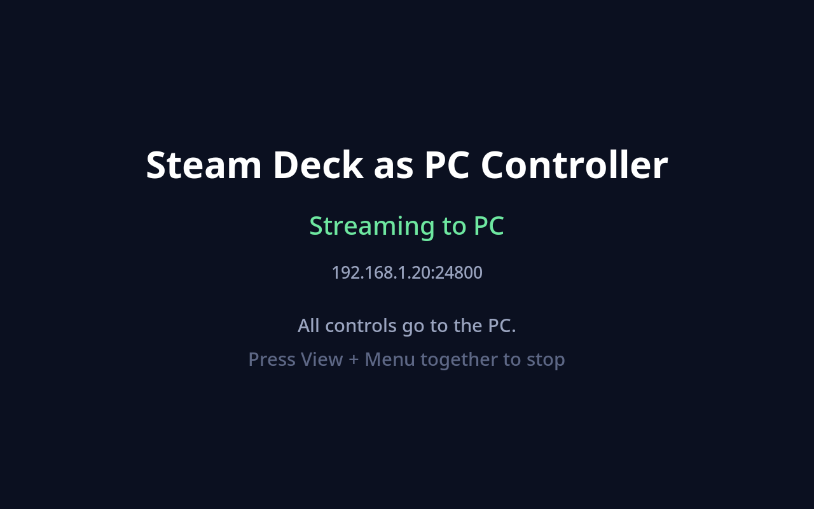

# Steam Deck as PC Controller

Use your Steam Deck as a controller for a Linux PC. The Deck streams its buttons, sticks, triggers,
trackpads and gyro over your network to the PC, where they appear as a **Steam Controller** (Steam and
games treat it as a real one, gyro and trackpads included) or as a plain **Xbox 360 pad**.

```
 Steam Deck                                         Linux PC
┌───────────────────────────┐   UDP :24800   ┌───────────────────────────────┐
│ Steam library entry       │ ─────────────▶ │ deck-virtual-controller-server│
│  └ deck-controller-app    │  (Wi-Fi/LAN)   │  ├ "steam": /dev/uhid  ──▶ Steam Controller (28de:1302)
│     └ ...-client          │                │  └ "xbox":  /dev/uinput ─▶ Xbox 360 pad
│        reads Deck hidraw  │                └───────────────────────────────┘
└───────────────────────────┘
```

Open **Deck Virtual Controller** from the Steam library on the Deck to start streaming; press
**View + Menu** together to stop (or close the game from the Steam menu).



> The Deck's USB-C port is host-only, so the link has to be network-based. A USB cable alone can't carry the data.

## Requirements

- **Deck:** SteamOS, reachable from the PC over SSH (`ssh deck@deck` by default). Desktop Mode's SSH must be enabled (`sudo systemctl enable --now sshd`, with a password set via `passwd`).
- **PC:** x86-64 Linux with systemd, the `uhid` and `uinput` kernel modules, and the Rust toolchain only if you build from source. Steam on the PC is needed for the `steam` controller type to be useful.
- Both on the same network, with **UDP port 24800** open on the PC.

## Quick start

Get the code (clone this repo, or download and extract a release tarball from the Releases page; releases contain prebuilt static binaries).

1. **PC:** install the server and its service.

   ```sh
   scripts/install-pc.sh
   ```

   It prints the few steps that need root (udev rule for `/dev/uhid` and `/dev/uinput`, kernel modules at boot).
   Review and run them, or let the script do it with `scripts/install-pc.sh --sudo`. Your user must be in the
   `input` group. Open UDP 24800 in your firewall if you have one.

2. **Deck:** install the client and the Steam library entry, from the PC.

   ```sh
   scripts/install-deck.sh                                # deck@deck, PC address auto-detected
   scripts/install-deck.sh --deck me@192.168.1.50 --pc 192.168.1.20
   ```

   This restarts Steam on the Deck once, to pick up the new library entry (existing entries are untouched and
   `shortcuts.vdf` is backed up first).

3. On the Deck, switch to Game Mode and start **Deck Virtual Controller** from the library (Non-Steam).
   The screen shows *Streaming to PC*. On the PC, Steam should now list a Steam Controller.

## Controller types

Set `controller_type` in the server's `config.toml`:

| Type | Appears as | Supports |
|---|---|---|
| `steam` (default) | Steam Controller (2026), USB ID `28de:1302`, via `/dev/uhid` | buttons, sticks, triggers, both trackpads (touch, click, pressure), gyro/accelerometer, four rear grips, quick-access button |
| `xbox` | Xbox 360 controller, `045e:028e`, via `/dev/uinput` | buttons, sticks, triggers, d-pad |

Deck control mapping for `steam`: Deck sticks and triggers map to the same controls; L4/L5/R4/R5 become the
four rear grips; the `...` button becomes quick access; the trackpads and IMU are passed through unchanged.

## Configuration

Both programs read a `config.toml` (first found of: `--config <path>`, `./config.toml`,
`~/.config/<program>/config.toml`). Missing keys use the defaults below. Examples are in `deploy/`.

**Server** (`deck-virtual-controller-server`, on the PC):

| Key | Default | Meaning |
|---|---|---|
| `bind_addr` | `0.0.0.0:24800` | UDP address to listen on |
| `timeout_ms` | `1000` | release all inputs if the Deck is silent this long (at least `200`, so that the Deck's heartbeat can keep up) |
| `controller_type` | `steam` | `steam` or `xbox` |
| `name` | `Steam Deck Virtual Controller` | name of the virtual device |

**Client** (`deck-virtual-controller-client`, on the Deck; the installer sets `server_addr`):

| Key | Default | Meaning |
|---|---|---|
| `server_addr` | none, required | `host:port` of the PC |
| `source` | `hidraw` | `hidraw` reads the Deck hardware directly (works in Game Mode with any Steam layout); `evdev` reads a Linux gamepad device |
| `device` | auto | (evdev only) device path or name |
| `heartbeat_ms` | `100` | resend interval when nothing changes (`10` to `500`: the server drops a Deck that is silent for its `timeout_ms`) |
| `deadzone` | `0` | stick deadzone in raw units (sticks span ±32767) |
| `stick_noise` | `128` | stick movement smaller than this since the last value sent is jitter and is not sent; `0` sends every change |

## How it works

- **Deck:** `deck-controller-app` (a fullscreen Tk status screen) runs the client as a child process, so closing the
  game in Steam stops streaming. The client reads the Deck's raw HID state reports from `/dev/hidraw*` (so it works
  regardless of Steam Input layouts), and sends a 50-byte UDP packet on every change plus a heartbeat.
  Pressing View + Menu together sends a neutral state and exits.
- **PC, `steam` type:** the server creates a HID device through `/dev/uhid` that copies a real 2026 Steam
  Controller: its USB IDs, report descriptor and feature-report handshake. It then streams `0x42` input reports at
  250 Hz, because Steam drops a controller that goes quiet. The kernel's `hid-steam` driver and the Steam client
  treat it like the real thing.
- **PC, `xbox` type:** a uinput gamepad with the usual Xbox 360 identity.

## Troubleshooting

- **`cannot create uhid device ... need write access to /dev/uhid`:** run the root steps from `install-pc.sh`
  (udev rule + `sudo modprobe uhid`), make sure you're in the `input` group (log out and in after adding), and check
  `ls -l /dev/uhid` shows group `input`, mode `0660`.
- **Deck shows "Cannot start" in red:** the client could not run for a reason you have to fix (an unedited
  `server_addr`, a `heartbeat_ms` the server would not tolerate, ...); the screen says which. Close the game from the
  Steam menu, fix `~/.config/deck-virtual-controller-client/config.toml`, and start it again.
- **Deck shows "Streaming" but nothing happens on the PC:** check the server log
  (`journalctl --user -u deck-virtual-controller-server -f`) for `client connected`. If it never appears, the
  firewall is blocking UDP 24800 or `server_addr` is wrong (`~/.config/deck-virtual-controller-client/config.toml` on the Deck).
- **Steam doesn't list the controller:** look at `~/.local/share/Steam/logs/controller.txt` on the PC for the
  `28de 1302` device. With the real controller plugged in at the same time, Steam may prefer that one.
- **Screen says "no controller data yet":** the client could not read the Deck's hidraw device; run it with
  `source = "evdev"` as a fallback.

## Known limitations

- The Deck and the PC must run the same version: the packet and ack formats carry a protocol version, and a mismatch
  shows on the Deck as "PC speaks another version" (and in the server log) instead of silently not working.
- **No authentication or encryption.** Any machine that can reach UDP 24800 on the PC can send controller input.
  Only run it on a network you trust (or firewall the port to the Deck's address).
- The **Steam button** (and the `...` button) on the Deck still opens the Deck's own Steam menu. Steam handles those
  itself before this app sees a press; the PC still receives them.
- Gyro, accelerometer and trackpad values are passed through without recalibration, assuming the Deck and the
  Steam Controller sensors use the same scaling. The Deck's right trackpad pressure range differs slightly.
- Rumble and haptics from the PC are not sent back to the Deck.
- While the PC uses the gyro, an idle Deck still sends about 160 packets per second (sensor noise). When the PC doesn't
  use it (Xbox type, or the host switched the gyro off) the Deck stops sending motion data and an idle Deck sends
  only its 10 per second heartbeat.

## Releasing

Bump `[workspace.package] version` in `Cargo.toml` (it is what `--version` prints and what shows in the first log
line), commit, and push a tag `vX.Y.Z` with the same number: the release workflow builds and attaches the tarball,
and `scripts/package.sh` refuses a tag that disagrees with the crate version. Both programs also print the
protocol version; the Deck and the PC must run builds with the same one.

## Uninstall

```sh
scripts/uninstall-deck.sh [--deck user@host]   # also removes the Steam library entry (restarts Steam)
scripts/uninstall-pc.sh                        # config is kept; it lists the root-owned files to remove
```

## Development

```sh
scripts/check.sh            # everything CI runs
scripts/check.sh rust       # or one group: rust, python, shell
```

`scripts/check.sh` is the one place that lists what is checked (formatting, clippy, the Rust tests and static
builds; the Python unit tests; shellcheck and the installer, helper and packaging tests). It runs every step, then
summarises; a step whose tool is missing (shellcheck, the musl target) is reported as skipped, and CI sets
`CHECK_STRICT=1` so a skip fails there. New tests are picked up automatically (cargo tests, `unittest` discovery, `scripts/tests/test-*.sh`); a new *kind* of
check is added to that script and nowhere else.

The code is a Cargo workspace split along the Deck / PC seam; each side depends only on `dvc-common`:

| Crate | Contains |
|---|---|
| `crates/common` | `controller` (named buttons, controller state), `proto` (wire format, one field table), `xbox_pad` (evdev vocabulary), `config`, `startup`, `log` (leveled stderr log lines, capturable in tests) and `timing` (the durations both sides must agree on, and their required order) |
| `crates/deck` | `source` (keeps an input source alive: discovery, retry, status), with adapters `deck_hid` (Deck hardware) and `evdev_source`; `publisher` (what becomes a packet), `link` (is the server answering), `status` (the contract with the Deck app); binary `deck-virtual-controller-client` |
| `crates/e2e` | test-only: runs the real client wiring (`dvc_deck::run`) against the real server wiring (`dvc_pc::run`) over loopback UDP with a fake Deck and a recording sink; the only crate that links both sides |
| `crates/pc` | `session` (who we listen to), `serve` (one receive step), `sink` (+ `xbox_sink` and `steam_controller`: `identity`, `device`, `report`, over `uhid`); binary `deck-virtual-controller-server` |

`steam_controller`'s tests compare against a report captured from a real controller and drive the whole device over
a fake kernel (a socket pair standing in for `/dev/uhid`), so CI needs no real device, and `deck_hid`'s against one
captured from a real Deck. Where things are installed on the Deck is defined once in `deploy/deck-layout.env`, read by the install scripts, the
Deck-side helper and the Steam shortcut tool; `deploy/tests/test_layout.py` fails if anything else repeats it.
The Deck app (`deck/`) talks to the client only through the lines and exit status described
in `crates/deck/src/status.rs`; `contract/status_contract.txt` lists them and both the Rust and Python tests read it. Releases are built by GitHub Actions when a `v*` tag is pushed.

## License

MIT, see [LICENSE](LICENSE).
